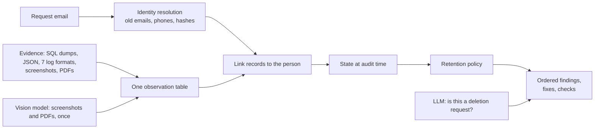

# Ghost Data Still Exists: deletion audit agent


Built by [Mayank](https://github.com/mayankgts) for HackerRank Orchestrate (October 2026).

When a customer asks a company to delete their data, the internal dashboard often says "Complete" while
copies survive in search indexes, database replicas, support tickets, analytics and backups. This agent
checks each request against the evidence and proves whether the data is really gone. If it isn't, the
agent lists what remains, the fixes in a safe order, and the checks that must pass afterwards.

## Example

The workflow said this customer's deletion was "COMPLETE". The agent found otherwise:

| # | Phase | What | Where |
|---|---|---|---|
| 1 | Finding | Search entry still exists | search_service / search_052 |
| 2 | Finding | Support ticket still shows their email | support_platform / support_864 |
| 3 | Finding | A sync job is still copying their data | integration_service / data_flow_9522 |
| 4 | Fix | Disable the sync job first, so nothing gets recreated | data_flow_9522 |
| 5 | Fix | Delete the search entry and redact the ticket | search_052, support_864 |
| 6 | Check | Confirm the account is gone and the security log is kept, as policy requires | account_4248, audit_record_9394 |

Every finding cites the evidence file that proves it. (Sample case_11, condensed from 14 steps.)

## Results

| Measured on the 32 cases that come with answers | Score |
|---|---|
| Correct verdict (complete, incomplete, not a deletion request) | 100% |
| Steps written that were correct (precision) | 100% |
| Steps in the answer key that were found (recall) | 90.7% |
| Correct evidence cited | 100% |

The other 518 cases are graded by HackerRank. All 518 output rows pass the format and policy checks I
wrote, and the full run cost about $0.13 in model calls.

## How it works



Everything is plain Python except two model calls: reading 15 screenshots and PDFs once, and deciding
whether each request actually asks for deletion. Parsing the logs and databases in code keeps every record
id exact, which is why the agent wrote no wrong steps on the samples.

## Design decisions

- Dashboards and activity logs only report what a system claims happened. A record's state comes from
  evidence that existed at the audit time.
- Most deleted accounts had no name or email left, only a log line saying "deleted account X". The deletion
  job processes each day's requests together, and its result matched what the customer was told in 128 of
  129 known cases, so I could work out which account belonged to whom. When two people could still own the
  same account, the agent leaves that step out, because a wrong step would cost both precision and recall.
- The vision model once invented a record id from a file name. The scorer caught it, and the prompt now
  accepts only ids printed on the page.

The full list of failures found and fixed, with scores after each, is in the
[evaluation report](code/evaluation/evaluation_report.md).

## Running it

The dataset belongs to HackerRank and is not included. Copy the `dataset/` folder from
[interviewstreet/hackerrank-orchestrate-october26](https://github.com/interviewstreet/hackerrank-orchestrate-october26)
into this repository's root, then:

```
python code/evidence.py
python code/main.py --samples && python code/evaluation/main.py
python code/main.py
```

Screenshot and PDF extractions are cached in `code/cache/vision/`, so no API key is needed. Architecture
details are in [code/README.md](code/README.md) and costs in
[code/evaluation/usage_report.md](code/evaluation/usage_report.md).

## How AI was used

I built this with an AI assistant (Claude), and the agent itself uses Gemini models for vision and intent.
Every change was checked against a scorer on the labelled samples before it was kept, and the full
development transcript was submitted with the solution.

## Author

Mayank, M.Tech Computer Science and Engineering, Manipal Institute of Technology, Bengaluru.
GitHub: [@mayankgts](https://github.com/mayankgts)

The problem statement and dataset belong to HackerRank. This repository contains only my solution.